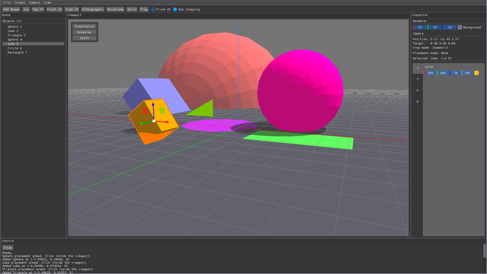

# SliyanEngine

A 3D editor and physics simulation engine built with **C++20 and OpenGL**, inspired by Blender, Houdini, and modern game engines.

SliyanEngine provides an interactive environment for creating, selecting, transforming, and organizing 2D and 3D objects, with a foundation for real-time physics simulations.

## Features

### 3D Rendering

-   OpenGL-based viewport renderer
-   Solid and wireframe visualization
-   3D grid and coordinate axes
-   GLSL shaders and rendering pipelines
-   Shader infrastructure for lighting, shadows, and outlines
    

### Scene Editor

-   Create 2D shapes: Triangle, Rectangle, Circle
-   Create 3D shapes: Cube, Sphere
-   Select and delete objects
-   Hierarchical scene organization
-   Scene panel for object management
-   Inspector for editing object properties
    

### Transformations

-   Interactive translation, rotation, and scale gizmos
-   Object position, rotation, and scale controls
-   Visual transformations using ImGuizmo
    

### Camera

-   Interactive camera movement and navigation
-   Perspective and orthographic projections
-   Isometric view
-   Top (XY), Front (XZ), and Side (YZ) views
    

### Physics

-   Rigid body and collider architecture
-   Physics world and simulation system
-   Collision detection components
-   Collider factory and collision representations
    

### Editor Interface

-   Dockable Dear ImGui interface
-   Viewport, Scene, Inspector, and Console panels
-   Toolbar and menu bar
-   Object creation popup
-   Right-click context menu
-   Gizmo controls
    

### Architecture

-   Modular C++20 design
-   Command pattern for editor actions
-   Strategy pattern for camera views and gizmos
-   Shape factory and scene management
-   Separate rendering, input, physics, and UI systems

## Status

**Work in progress.** The editor includes core scene manipulation and rendering functionality, with physics, collision handling, and advanced visual effects under development.
